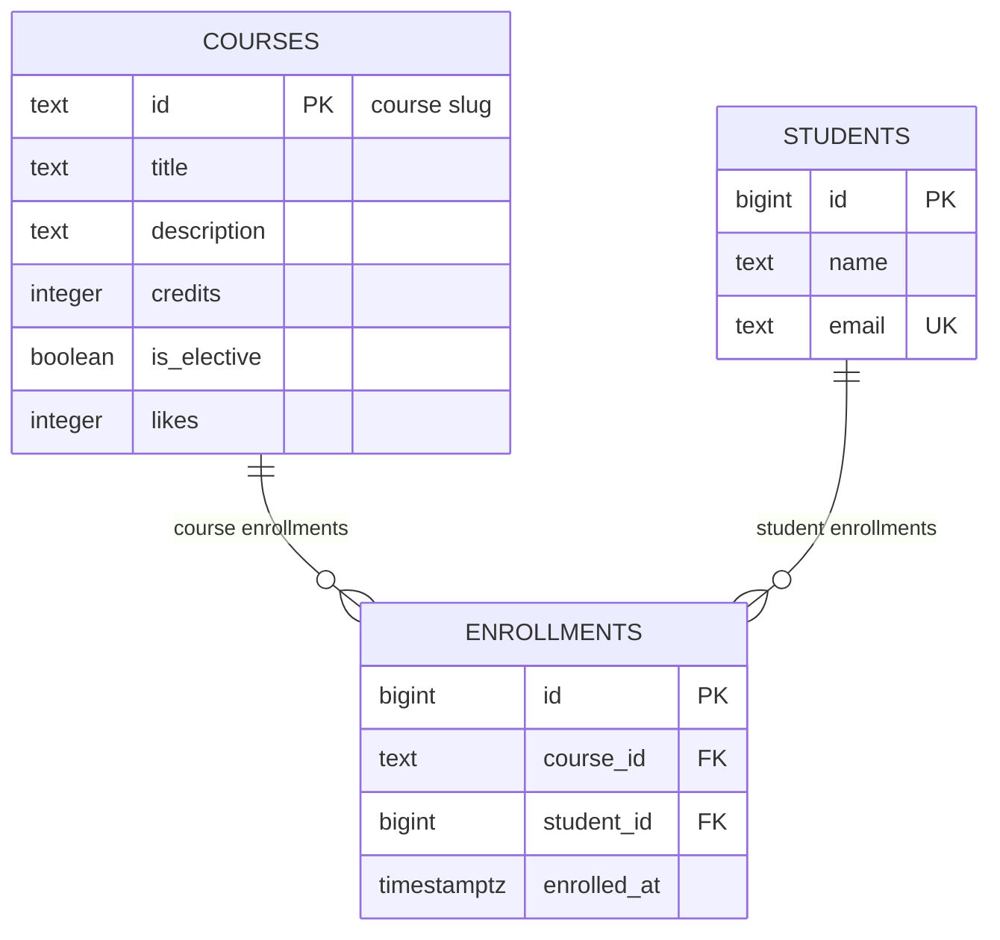

# course-catalog-db

PostgreSQL schema and query suite for the course catalog (Lab 6, “Advanced Web Technologies”).

Репозиторий содержит полную схему реляционной базы данных PostgreSQL для каталога курсов, начальные данные (seed), аналитические и рабочие SQL-запросы к маршрутам API, логи тестирования ограничений (constraints), исследование производительности индексов с помощью `EXPLAIN ANALYZE` и демонстрацию транзакционной целостности.

---

## 🚀 How to run (Инструкция по запуску)

Для работы требуется **PostgreSQL 16 или новее** (в лабораторной используется версия 18).

### Вариант 1: Быстрый запуск через Docker (Рекомендуемый)

Если PostgreSQL не установлен локально, запустите контейнер:

```bash
# Запуск контейнера на порту 5433 (если стандартный 5432 уже занят локальным PostgreSQL):
docker run --name pg -e POSTGRES_PASSWORD=postgres -p 5433:5432 -d postgres:18-alpine
```

Создайте роль и базы данных:

```bash
docker exec -i pg psql -U postgres -c "CREATE ROLE catalog_app LOGIN PASSWORD 'change-me';"
docker exec -i pg psql -U postgres -c "CREATE DATABASE course_catalog OWNER catalog_app;"
docker exec -i pg psql -U postgres -c "CREATE DATABASE idx_demo OWNER catalog_app;"
docker exec -i pg psql -U postgres -c "CREATE DATABASE norm_demo OWNER catalog_app;"
```

Запустите скрипты схемы, начальных данных и запросов:

```bash
# PowerShell (Windows):
Get-Content schema.sql -Raw | docker exec -i pg psql -U catalog_app -d course_catalog -v ON_ERROR_STOP=1
Get-Content seed.sql -Raw | docker exec -i pg psql -U catalog_app -d course_catalog -v ON_ERROR_STOP=1
Get-Content queries.sql -Raw | docker exec -i pg psql -U catalog_app -d course_catalog -v ON_ERROR_STOP=1

# Bash (Linux / macOS):
docker exec -i pg psql -U catalog_app -d course_catalog -v ON_ERROR_STOP=1 < schema.sql
docker exec -i pg psql -U catalog_app -d course_catalog -v ON_ERROR_STOP=1 < seed.sql
docker exec -i pg psql -U catalog_app -d course_catalog -v ON_ERROR_STOP=1 < queries.sql
```

---

### Вариант 2: Локальный PostgreSQL и утилита psql

1. Подключитесь от суперпользователя `postgres`:
```sql
CREATE ROLE catalog_app LOGIN PASSWORD 'change-me';
CREATE DATABASE course_catalog OWNER catalog_app;
CREATE DATABASE idx_demo OWNER catalog_app;
CREATE DATABASE norm_demo OWNER catalog_app;
```

2. Выполните скрипты из папки проекта с флагом немедленной остановки при первой ошибке (`-v ON_ERROR_STOP=1`):

```bash
psql -h localhost -U catalog_app -d course_catalog -v ON_ERROR_STOP=1 -f schema.sql
psql -h localhost -U catalog_app -d course_catalog -v ON_ERROR_STOP=1 -f seed.sql
psql -h localhost -U catalog_app -d course_catalog -v ON_ERROR_STOP=1 -f queries.sql
```

> **Примечание по безопасности:** Пароль `change-me` используется исключительно в учебных целях. В реальных продуктовых проектах пароли хранятся в секретах окружения (`.env`) и не попадают в систему контроля версий.

---

## 🏛️ Schema (Схема базы данных)



База данных состоит из трех таблиц: `courses` (каталог курсов), `students` (студенты) и `enrollments` (записи на курсы). Сущности `courses` и `students` находятся в отношении **«многие-ко-многим» (M:N)**: один курс может иметь множество студентов, а студент может записаться на множество курсов. Это отношение декомпозировано в две связи типа «один-ко-многим» (`1:M`) через связующую ассоциативную таблицу `enrollments`. Уникальное составное ограничение `UNIQUE (course_id, student_id)` гарантирует, что студент не сможет записаться на один и тот же курс дважды.

---

## 💡 Design decisions (Архитектурные и проектные решения)

- **Почему `courses.id` — это `text` (slug), а `students.id` — автоматический `bigint` (identity)?**
  - **Для курсов (`slug`):** Курсы идентифицируются семантическими человекопонятными слагами (например, `modern-frontend`, `databases-postgresql`). Это обеспечивает красивые и SEO-оптимизированные URL в адресной строке (`/courses/modern-frontend`), избавляет от лишних `JOIN` для получения слага и сразу понятно администраторам. Минус: при переименовании слага требуется каскадное обновление внешних ключей.
  - **Для студентов (`bigint identity`):** Персональные данные людей (имена, почта) могут меняться, не несут неизменного естественного идентификатора и не должны раскрываться в открытых идентификаторах. `bigint GENERATED ALWAYS AS IDENTITY` гарантирует строгую неизменяемость первичного ключа, компактность во внешних ключах и неограниченный запас номеров (до $9 \times 10^{18}$ записей).
- **Почему `RESTRICT` на `enrollments.course_id`, но `CASCADE` на `enrollments.student_id`?**
  - `enrollments.course_id ON DELETE RESTRICT`: Курс представляет собой ключевую академическую сущность. Если на курс уже записаны студенты, удаление курса приведет к потере истории и образовательных записей. База данных блокирует удаление такого курса, пока записи не будут архивированы или перенесены вручную.
  - `enrollments.student_id ON DELETE CASCADE`: Студент является владельцем своих записей. При удалении учетной записи студента (согласно GDPR / праву на забвение) все связанные с ним записи на курсы должны автоматически удаляться, чтобы не оставлять «висячих» ссылок на несуществующего учащегося.
- **Почему `timestamptz` вместо `timestamp` и `text` вместо `varchar(n)`?**
  - `timestamptz` (`timestamp with time zone`): Сохраняет точный момент времени во внутреннем формате UTC и корректно конвертирует его в локальное время любого клиента. Обычный `timestamp` не хранит смещение и приводит к путанице при работе пользователей из разных часовых поясов.
  - `text` вместо `varchar(n)`: В PostgreSQL типы `text` и `varchar(n)` используют одинаковое внутреннее представление (varlena), обладают абсолютно равной производительностью и механизмами сжатия (TOAST). Искусственные лимиты вроде `varchar(255)` — легаси других СУБД. В PostgreSQL гибче использовать `text`, а осмысленные ограничения длины (например, `length(name) >= 2`) задавать через выразительные `CHECK`-констрейнты.

---

## 📋 Constraint violation log (Журнал нарушения ограничений)

Все команды проверялись в `psql` с включенным подробным выводом: `\set VERBOSITY verbose`.

| # | Что нарушаем | SQLSTATE | Ограничение (Constraint) | Ответ API | Обоснование / Поведение |
|---|--------------|----------|--------------------------|-----------|-------------------------|
| 1 | `NULL` в `courses.title` | `23502` | `title` (`COLUMN NAME`, `NOT NULL`) | `422 Unprocessable Entity` | Отсутствие обязательного поля модели запроса (500, если валидатор API пропустил баг). |
| 2 | `courses.credits = 0` | `23514` | `courses_credits_check` | `422 Unprocessable Entity` | Нарушение бизнес-правила: количество кредитов должно быть строго больше нуля. |
| 3 | `courses.likes = -1` | `23514` | `courses_likes_check` | `500 Internal Server Error` | Лайки инкрементируются сервером (`likes + 1`), отрицательное значение означает баг в коде. |
| 4 | Имя студента из одной буквы (`'A'`) | `23514` | `students_name_check` | `422 Unprocessable Entity` | Ошибка валидации пользовательского ввода: длина имени минимум 2 символа. |
| 5 | Дубликат email студента | `23505` | `students_email_key` | `409 Conflict` | Нарушение уникальности: студент с таким email уже зарегистрирован. |
| 6 | Дубликат ID курса (`'api-design'`) | `23505` | `courses_pkey` | `409 Conflict` | Конфликт первичного ключа: курс с таким слагом уже существует. |
| 7 | Повторная запись студента на курс | `23505` | `enrollments_course_id_student_id_key` | `409 Conflict` | Нельзя записать студента на курс дважды. |
| 8 | Запись на несуществующий курс | `23503` | `enrollments_course_id_fkey` | `404 Not Found` | Внешний ключ не найден: запрашиваемый курс не существует. |
| 9 | Запись несуществующего студента | `23503` | `enrollments_student_id_fkey` | `404 Not Found` | Внешний ключ не найден: указанный студент не найден в базе (или 422). |
| 10 | Удаление курса, на который есть записи | `23001` (PG 18) / `23503` (PG 16-17) | `enrollments_course_id_fkey` | `409 Conflict` | Запрещено правилом `RESTRICT`: нельзя удалить курс, пока на него записаны студенты. |
| 11 | Удаление студента (каскадный тест) | — | `enrollments_student_id_fkey` (`ON DELETE CASCADE`) | `204 No Content` / `200 OK` | Ошибки нет: записи студента каскадно удалились базой (6 → 3 записей, после ROLLBACK вернулось 6). |

### Вопрос: Зачем проверять в БД, если Pydantic в коде API уже проверяет длину имени (`min_length=2`)?

Pydantic валидирует входящие данные только в рамках конкретного HTTP-запроса через FastAPI. Однако база данных в промышленной среде доступна не только через веб-API. Напрямую в базу данных могут писать:
1. Администраторы и техподдержка через CLI (`psql`) или GUI-клиенты (DBeaver, DataGrip).
2. Миграционные скрипты (Alembic) и скрипты начального наполнения (seed/fixtures).
3. Фоновые очереди задач (Celery, ARQ), микросервисы или аналитические ETL-пайплайны.
4. Разработчики при непреднамеренных ошибках в коде (например, баг в обходе валидации или прямой raw-запрос).

Ограничения на стороне СУБД реализуют принцип **многоуровневой защиты (Defense in Depth)**. База данных — это последний и фундаментальный рубеж защиты, гарантирующий, что некорректные данные физически не могут оказаться в хранилище.

---

## ⚡ Index: EXPLAIN before and after (Исследование производительности индексов)

Эксперимент проводился в тестовой базе `idx_demo` с большим объемом синтетических данных: **500 курсов, 20 000 студентов и 50 000 записей на курсы**.

Тестируемый запрос:
```sql
SELECT * FROM enrollments WHERE student_id = 777;
```

### Сравнительная таблица метрик

| Метрика | До создания индекса | После создания индекса |
|---|-------------------|------------------------|
| **Метод доступа (Access method)** | `Seq Scan on enrollments` | `Bitmap Heap Scan` via `Bitmap Index Scan` |
| **Стоимость (cost)** | `0.00..1042.00` | `4.31..15.59` |
| **Строк отброшено фильтром (Rows Removed by Filter)** | `49997` | `0` |
| **Время выполнения (Execution Time)** | `1.312 ms` | `0.041 ms` |
| **Ускорение** | — | **~32 раза быстрее** |

### 1. План выполнения ДО создания индекса (`Seq Scan`)
```text
Seq Scan on enrollments  (cost=0.00..1042.00 rows=3 width=34) (actual time=0.023..1.306 rows=3.00 loops=1)
  Filter: (student_id = 777)
  Rows Removed by Filter: 49997
  Buffers: shared hit=417
Planning Time: 0.024 ms
Execution Time: 1.312 ms
```
*Интерпретация:* СУБД была вынуждена последовательно просканировать всю таблицу (417 страниц в буфере, 50 000 строк) и отбросить 49 997 записей ради поиска всего 3 нужных строк.

### 2. План выполнения ПОСЛЕ создания индекса (`Bitmap Index Scan`)
```text
Bitmap Heap Scan on enrollments  (cost=4.31..15.59 rows=3 width=34) (actual time=0.014..0.015 rows=3.00 loops=1)
  Recheck Cond: (student_id = 777)
  Heap Blocks: exact=3
  Buffers: shared hit=5
  ->  Bitmap Index Scan on enrollments_student_id_idx  (cost=0.00..4.31 rows=3 width=0) (actual time=0.011..0.011 rows=3.00 loops=1)
        Index Cond: (student_id = 777)
        Index Searches: 1
        Buffers: shared hit=2
Planning Time: 0.024 ms
Execution Time: 0.041 ms
```
*Интерпретация:* СУБД обратилась к B-дереву индекса `enrollments_student_id_idx`, за 2 чтения буфера нашла точные ссылки на блоки таблицы и прочитала ровно 3 страницы таблицы.

### Ответы на вопросы:

1. **Почему PostgreSQL не создал индекс на `enrollments.student_id` автоматически, хотя создал на `email` и `course_id`?**
   PostgreSQL автоматически создает B-дерево индексы исключительно для ограничений `PRIMARY KEY` и `UNIQUE` (для физического поддержания уникальности при вставках). Для внешних ключей (`FOREIGN KEY`) индексы автоматически **не строятся**, так как любой индекс замедляет операции `INSERT`, `UPDATE`, `DELETE` и занимает место на диске (в нашем тесте индекс занял 896 КБ при размере таблицы 3336 КБ). Внешний ключ накладывает только правило проверки целостности, а решение об индексе возлагается на разработчика.
2. **Почему поиск по первичному ключу в `courses` (6 строк) использует `Seq Scan`, а в `enrollments` (50 000 строк) идет по индексу?**
   Планировщик запросов (Cost-Based Optimizer) рассчитывает ожидаемую стоимость ввода-вывода. Таблица из 6 строк занимает ровно один страничный блок (8 КБ). Стоимость последовательного чтения одного блока (`Seq Scan`) составляет всего `cost=1.07`. Чтение через индекс потребовало бы сначала прочитать блок индекса, а затем блок данных, что дороже и медленнее. На 50 000 строк последовательное сканирование стоит `cost=1042`, тогда как индексный поиск стоит всего `15.59`. Наличие индекса не означает обязательного его использования — всё решает расчётная стоимость.
3. **Назовите две операции, которые ускорит индекс на `student_id`:**
   - **Каскадное удаление (`ON DELETE CASCADE`):** При удалении студента из таблицы `students` базе необходимо найти все его записи в таблице `enrollments`. Без индекса удаление каждого студента приводило бы к `Seq Scan` всей многотысячной таблицы записей. С индексом удаление происходит мгновенно.
   - **Запросы записей конкретного студента и JOIN:** Выборки курсов для личного кабинета студента (`WHERE student_id = :id`) и объединения таблиц (`JOIN students s ON s.id = e.student_id`).

---

## 🔄 Transaction (Транзакции и изоляция)

Сценарий: регистрация нового студента и немедленная запись его на курс — две вставки как одна атомарная операция (`atomic operation`).

- **Сбой второй вставки и откат:**
  В транзакции (`BEGIN;`) успешно вставлен студент `Madina Ospanova` (`INSERT 0 1`). Вторая вставка в таблицу `enrollments` попыталась связать её с несуществующим курсом `'no-such-course'` и завершилась ошибкой внешнего ключа `23503`. Транзакция немедленно перешла в аварийное состояние `aborted` (приглашение psql изменилось на `course_catalog=!>`), в котором отвергаются любые последующие команды (`current transaction is aborted, commands ignored until end of transaction block`). Команда `ROLLBACK;` полностью отменила транзакцию. Проверочный запрос `SELECT count(*) FROM students WHERE email = 'madina@example.com'` показал `0`: студентка в базе не появилась.
- **Поведение при параллельном наблюдении (два терминала):**
  - **Окно А** открыло транзакцию и выполнило обе корректные вставки (в `students` и `enrollments`), но не вызывало `COMMIT`.
  - **Окно B** сделало запрос `SELECT` по почте Мадины и получило `0 rows`. Изменения Окна А невидимы другим соединениям, поскольку уровень изоляции по умолчанию в PostgreSQL — **`read committed`** (видны только зафиксированные транзакции).
  - После вызова `COMMIT;` в Окне А, Окно B мгновенно увидело появление обоих связанных объектов в согласованном состоянии.
- **Что произошло бы без транзакции при сбое второй команды?**
  Без транзакции каждая команда фиксируется немедленно (autocommit). Студент был бы навсегда записан в базу данных, а запись на курс упала бы с ошибкой. В системе возник бы «фантомный» студент без курсов и нарушилась бы согласованность предметной модели (inconsistent data state).

---

## ✅ Self-review against the checklist (Самопроверка по чек-листу)

| Что проверяем | Результат | Комментарий |
|---|---|---|
| **Keys (Ключи)** | **Да** | В каждой таблице определен суррогатный или естественный первичный ключ (`PRIMARY KEY`). Для связей настроены внешние ключи `FOREIGN KEY`. |
| **Types (Типы)** | **Да** | Метки времени используют `timestamptz`, идентификаторы счетчиков — `bigint`, текстовые поля — `text`, логические флаги — `boolean`. |
| **Required values (Обязательность)** | **Да** | Все столбцы, где значение обязательно для бизнес-логики, объявлены с `NOT NULL`. Полям `likes`, `is_elective`, `enrolled_at` заданы корректные `DEFAULT`. |
| **Constraints (Ограничения)** | **Да** | Правила предметной области описаны через `CHECK (credits > 0)`, `CHECK (likes >= 0)`, `CHECK (length(name) >= 2)` и `UNIQUE` на email и пару `(course_id, student_id)`. |
| **Deletion (Поведение при удалении)** | **Да** | Осознанно выбраны политики: `ON DELETE RESTRICT` для курсов (защита учебных данных) и `ON DELETE CASCADE` для студентов (чистка связанных записей). |
| **Normalization (Нормализация)** | **Да** | Схема находится в 3-й нормальной форме (3NF): нет дублирования данных, отсутствуют мультизначные ячейки, исключены аномалии вставки/удаления/обновления. |
| **Indexes and names (Индексы и имена)** | **Да** | Добавлен индекс на внешний ключ `enrollments.student_id`. Все идентификаторы и таблицы оформлены в строгом `snake_case` в едином стиле. |

---

## 🎁 Bonus tasks (Бонусные задания)

### Бонус 1. Нормализация: 3 аномалии плоской таблицы (`norm_demo`)
В базе `norm_demo` была исследована плоская денормализованная таблица `registrations` (скрипт `experiments/norm_demo.sql`):
1. **Аномалия обновления (Update Anomaly):** При изменении названия курса `modern-frontend` в одной строке, в остальных строках осталось старое название. Курс получил два разных названия одновременно, база стала несогласованной.
2. **Аномалия удаления (Delete Anomaly):** При удалении единственной записи Данияра на курс `backend-fastapi` из базы бесследно исчез сам курс и его кредиты, так как информация о курсе хранилась только внутри строки записи.
3. **Аномалия вставки (Insert Anomaly):** Невозможно добавить новый курс `web-security`, пока на него никто не записался, без вставки фиктивного студента со значениями `NULL`.

*Решение:* Разделение на 3 нормализованные таблицы (`courses`, `students`, `enrollments`) полностью устраняет все три аномалии, делая курсы и студентов независимыми сущностями.

### Бонус 2. Потерянное обновление (Lost Update) и блокировки строк
При подходе «прочитать в программу -> вычислить `likes + 1` -> записать обратно» при двух параллельных запросах оба клиента считывают `11` и записывают `12`, теряя один лайк (Lost Update).
Использование атомарного `UPDATE courses SET likes = likes + 1 WHERE id = ...` блокирует изменяемую строку на уровне строк (`RowExclusiveLock`). Второй параллельный клиент ожидает снятия блокировки, перечитывает уже обновленное значение `12` и корректно увеличивает его до `13`.

### Бонус 3. Защита от SQL-инъекций через параметризацию
Конкатенация строк в SQL приводит к инъекциям: строка `'x'' OR ''1''=''1'` обходит условие `WHERE` и возвращает все записи каталога.
Параметризованные запросы (`PREPARE by_id (text) AS SELECT ... WHERE id = $1;` и `EXECUTE by_id(...)`) передают параметры отдельно от структуры SQL-запроса через бинарный протокол. СУБД воспринимает аргумент исключительно как текстовый литерал, исключая изменение синтаксического дерева запроса.

### Бонус 4. Дополнительные аналитические запросы
В файл `queries.sql` добавлены:
- **Запрос 7:** Поиск курсов без единой записи (`LEFT JOIN ... WHERE e.id IS NULL`).
- **Запрос 8:** Поиск студентов, записанных более чем на один курс (`GROUP BY ... HAVING count(*) > 1`).

---

## 📁 Структура репозитория

```text
course-catalog-db/
├── schema.sql              # Схема БД: таблицы, ограничения, ключи и индекс
├── seed.sql                # Начальные данные (6 курсов, 3 студента, 6 записей)
├── queries.sql             # SQL-запросы для маршрутов API и аналитики
├── experiments/
│   ├── idx_data.sql        # Генерация 70 000+ строк для бенчмарка индексов
│   └── norm_demo.sql       # Плоская таблица для исследования аномалий 3NF
└── README.md               # Полная документация, ER-диаграмма, логи и чек-лист
```
