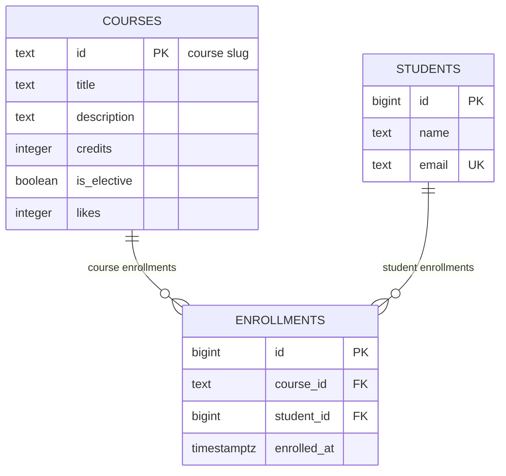

# course-catalog-db: Отчёт и результаты тестирования (Лабораторная 6)

Репозиторий содержит результаты проектирования и практического тестирования реляционной схемы PostgreSQL для каталога курсов: протокол нарушений ограничений целостности (constraints), исследование производительности индекса через `EXPLAIN ANALYZE` и проверку транзакционной изоляции (ACID).

---

## Схема базы данных (ER-модель)



Схема реализует отношение «многие-ко-многим» (M:N) через промежуточную таблицу `enrollments`. Ограничение `UNIQUE (course_id, student_id)` исключает дублирование записей студента на один и тот же курс.

---

## ТЕСТ 1. Проверка ограничений целостности (Constraint Violations)

Все команды проверялись в `psql` с подробным выводом ошибок (`\set VERBOSITY verbose`). База данных перехватывает некорректные операции и возвращает стандартизированные 5-значные коды `SQLSTATE`, которые API сопоставляет с HTTP-статусами:

| № | Проверяемая операция / Ошибка | Код SQLSTATE | Сработавшее ограничение (Constraint) | Ответ API | Обоснование и поведение |
|---|-------------------------------|--------------|--------------------------------------|-----------|-------------------------|
| 1 | `NULL` в обязательном поле `title` | `23502` | `courses.title` (`NOT NULL`) | **422 Unprocessable Entity** | Клиент не передал обязательное поле модели запроса. |
| 2 | Значение кредитов = 0 | `23514` | `courses_credits_check` (`CHECK`) | **422 Unprocessable Entity** | Нарушено бизнес-правило: кредиты курса должны быть строго больше нуля. |
| 3 | Отрицательное число лайков (`-1`) | `23514` | `courses_likes_check` (`CHECK`) | **500 Internal Server Error** | Лайки увеличивает только сервер. Отрицательное число означает баг в коде бэкенда. |
| 4 | Имя студента из 1 буквы (`'A'`) | `23514` | `students_name_check` (`CHECK`) | **422 Unprocessable Entity** | Ошибка валидации пользовательского ввода: длина имени минимум 2 символа. |
| 5 | Повторная регистрация существующего email | `23505` | `students_email_key` (`UNIQUE`) | **409 Conflict** | Конфликт уникальности: студент с таким email уже зарегистрирован. |
| 6 | Вставка дублирующего ID курса | `23505` | `courses_pkey` (`PRIMARY KEY`) | **409 Conflict** | Конфликт первичного ключа: курс с таким слагом уже существует. |
| 7 | Повторная запись студента на тот же курс | `23505` | `enrollments_course_id_student_id_key` (`UNIQUE`) | **409 Conflict** | Запрещено повторно записывать учащегося на один и тот же курс. |
| 8 | Запись на несуществующий курс | `23503` | `enrollments_course_id_fkey` (`FOREIGN KEY`) | **404 Not Found** | Курс с таким идентификатором физически не существует. |
| 9 | Запись несуществующего студента | `23503` | `enrollments_student_id_fkey` (`FOREIGN KEY`) | **404 Not Found** | Студент с таким номером не найден в базе данных. |
| 10 | Удаление курса, на который записаны студенты | `23001` (PG 18) / `23503` | `enrollments_course_id_fkey` (`ON DELETE RESTRICT`) | **409 Conflict** | Сработало правило `RESTRICT`: нельзя удалить курс, пока на него записаны учащиеся. |
| 11 | Удаление аккаунта студента | — (Успех) | `enrollments_student_id_fkey` (`ON DELETE CASCADE`) | **204 No Content** | База автоматически удалила все записи студента (число строк уменьшилось с 6 до 3). |

### Обоснование ограничений на уровне СУБД (Defense in Depth)

Ограничения `CHECK` и `NOT NULL` в схеме базы данных реализуют принцип многоуровневой защиты (*Defense in Depth*). Валидация в коде API (Pydantic) защищает исключительно входящие HTTP-запросы. В реальной системе данные в СУБД могут поступать минуя API: через миграции Alembic, консольные утилиты администратора (`psql`), фоновые задачи (Celery) или прямые аналитические выгрузки. База данных является единым источником правды (*Single Source of Truth*), и констрейнты СУБД физически гарантируют целостность данных в любых сценариях.

---

## ТЕСТ 2. Производительность индекса (EXPLAIN ANALYZE)

Эксперимент проведён в тестовой базе `idx_demo` на синтетическом наборе данных: **500 курсов, 20 000 студентов и 50 000 записей на курсы**.

Тестируемый запрос поиска записей конкретного студента:
```sql
EXPLAIN (ANALYZE, BUFFERS) SELECT * FROM enrollments WHERE student_id = 777;
```

### Сравнительные замеры

| Метрика | До создания индекса | После создания индекса |
|---|---|---|
| **Метод доступа (Access Method)** | `Seq Scan on enrollments` (полный перебор) | `Bitmap Heap Scan` + `Bitmap Index Scan` |
| **Расчётная стоимость (Cost)** | `0.00..1042.00` | `4.31..15.59` |
| **Отброшено строк фильтром (Rows Removed)** | **49 997 строк** | **0 строк** |
| **Прочитано блоков из памяти (Buffers)** | 417 блоков | 5 блоков (2 индекс + 3 таблица) |
| **Время выполнения (Execution Time)** | **1.312 ms** | **0.041 ms** |
| **Результат ускорения** | Линейное сканирование всей таблицы | **Запрос выполнился в 32 раза быстрее** |

### 1. План выполнения ДО индекса (Seq Scan)
```text
Seq Scan on enrollments  (cost=0.00..1042.00 rows=3 width=34) (actual time=0.023..1.306 rows=3.00 loops=1)
  Filter: (student_id = 777)
  Rows Removed by Filter: 49997
  Buffers: shared hit=417
Planning Time: 0.024 ms
Execution Time: 1.312 ms
```

### 2. План выполнения ПОСЛЕ индекса (Bitmap Index Scan)
Индекс создан командой:
```sql
CREATE INDEX enrollments_student_id_idx ON enrollments (student_id);
```
План выполнения:
```text
Bitmap Heap Scan on enrollments  (cost=4.31..15.59 rows=3 width=34) (actual time=0.014..0.015 rows=3.00 loops=1)
  Recheck Cond: (student_id = 777)
  Heap Blocks: exact=3
  Buffers: shared hit=5
  ->  Bitmap Index Scan on enrollments_student_id_idx  (cost=0.00..4.31 rows=3 width=0) (actual time=0.011..0.011 rows=3.00 loops=1)
        Index Cond: (student_id = 777)
        Index Searches: 1
        Buffers: shared hit=2
Planning Time: 0.024 ms
Execution Time: 0.041 ms
```

### Особенности работы индекса

- **Индексы внешних ключей:** PostgreSQL автоматически создает индексы исключительно для ограничений `PRIMARY KEY` и `UNIQUE` (для физического поддержания уникальности). Для внешних ключей (`FOREIGN KEY`) индексы автоматически не строятся, так как каждый индекс замедляет операции `INSERT`, `UPDATE` и `DELETE`, а также расходует дисковое пространство. По этой причине индекс на `enrollments.student_id` был добавлен явно.
- **Выбор плана оптимизатором:** На таблице `courses` (6 строк) оптимизатор выбирает `Seq Scan`, так как вся таблица занимает один страничный блок (стоимость 1.07), что быстрее и дешевле чтения индексного дерева. На 50 000 строк в таблице `enrollments` индекс снижает расчетную стоимость с 1042.00 до 15.59, поэтому оптимизатор переключается на индексный поиск.
- **Ускоряемые операции:** Созданный индекс ускоряет каскадное удаление (`ON DELETE CASCADE` при удалении студента), поиск курсов конкретного студента (`WHERE student_id = ?`) и объединения таблиц (`JOIN students s ON s.id = e.student_id`).

---

## ТЕСТ 3. Транзакции и уровни изоляции (ACID)

Сценарий: атомарная регистрация нового студента и немедленная запись его на курс (две операции как единое неделимое целое).

### 1. Тест отката при ошибке (Rollback on failure)
- Внутри блока `BEGIN;` выполнена вставка нового студента (`INSERT INTO students ...`).
- Вторая команда попыталась связать студента с несуществующим курсом (`INSERT INTO enrollments ... VALUES ('no-such-course', ...)`).
- Вторая операция завершилась ошибкой внешнего ключа `23503`. Транзакция немедленно перешла в защитное состояние `aborted` (приглашение консоли `course_catalog=!>`), блокируя дальнейшие действия.
- Команда `ROLLBACK;` вернула базу в исходное состояние. Проверочный запрос `SELECT count(*) FROM students WHERE email = 'madina@example.com'` вернул `0`.
- Атомарность гарантирует, что в базе не появляются изолированные записи без связей. Без использования транзакции первая операция зафиксировалась бы, оставив некорректное состояние данных.

### 2. Тест изоляции в параллельных сессиях (Read Committed)
- **Терминал А:** открыл транзакцию `BEGIN;`, вставил студента и запись на курс, но не выполнил `COMMIT;`.
- **Терминал B:** выполнил `SELECT` по почте студента и получил `0 строк`. Незафиксированные данные изолированы и не видны другим клиентам.
- **Терминал А:** выполнил `COMMIT;`.
- **Терминал B:** повторил `SELECT` и увидел обе согласованные записи.
- Подтверждена работа стандартного уровня изоляции PostgreSQL — **`Read Committed`** (клиенты видят только зафиксированные транзакции).

---

## 
